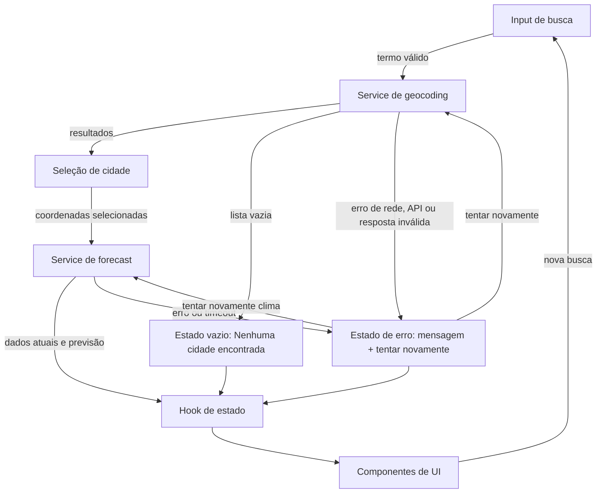

# Plano técnico — Weather App

Este plano deriva decisões e contratos de [`specs/weather-app-spec.md`](../specs/weather-app-spec.md). Ele descreve a arquitetura e as interfaces a implementar; não é código de produção.

## Arquitetura

Aplicação de página única, sem roteador ou backend próprio. As dependências seguem uma direção simples: `App` compõe a interface, `components` emitem ações, `hooks` orquestram estado e chamadas, `services` fazem I/O com Open-Meteo, e `lib` transforma/valida dados sem efeitos colaterais. `types` contém os contratos compartilhados. As camadas inferiores não importam componentes React nem estado da interface.



Uma busca só atualiza a lista de resultados. A seleção explícita de uma cidade inicia a consulta meteorológica. Uma única resposta da API de previsão contém condições atuais e dados diários; o serviço mapeia e valida cada parte separadamente para que falha de dados atuais não oculte uma previsão válida, nem o contrário. Isso atende RF-01–RF-05 e evita introduzir uma camada de backend sem requisito.

Essa separação cria fronteiras de teste: `lib` é verificada com testes unitários puros; `services` é testada com `fetch` controlado; `hooks` e `components` são testados com serviços simulados; e Playwright valida os fluxos completos na aplicação.

## Stack tecnológica

- **TypeScript strict, React 19 e Vite 8:** já presentes no projeto; interface tipada e desenvolvimento/build da SPA.
- **Tailwind CSS 3:** já configurado no projeto; estilos responsivos sem adicionar outra biblioteca visual.
- **Fetch e AbortController nativos:** chamadas HTTP e timeout de 10 segundos sem dependência de cliente HTTP.
- **Vitest, Testing Library e Playwright:** ferramentas já listadas no projeto para testes unitários, de componentes e E2E.
- **Biome:** lint e formatação existentes.
- **Sem biblioteca de estado, roteador ou cache:** o escopo é uma tela e estados locais; adicionar essas ferramentas não traz benefício necessário para a spec.

## Estrutura do projeto

```text
src/
├── components/
│   ├── CitySearch.tsx
│   ├── CurrentConditions.tsx
│   ├── DailyForecast.tsx
│   ├── UnitToggle.tsx
│   └── RequestStatus.tsx
├── hooks/
│   └── useWeather.ts
├── services/
│   └── openMeteo.ts
├── lib/
│   ├── weatherMapper.ts
│   ├── weatherCode.ts
│   └── temperature.ts
├── types/
│   └── weather.ts
└── App.tsx

tests/
├── unit/
├── components/
└── e2e/
```

- `components/` contém apenas apresentação e eventos: `CitySearch` exibe formulário/resultados; `CurrentConditions` e `DailyForecast` exibem dados e estados; `UnitToggle` escolhe unidade; `RequestStatus` apresenta carregamento, vazio e erro.
- `hooks/useWeather.ts` mantém estado da tela e orquestra busca, seleção, consulta e repetição. Não acessa `fetch` diretamente.
- `services/openMeteo.ts` monta URLs, executa `fetch`, aplica timeout e traduz falhas de transporte. Não conhece componentes nem estado React.
- `lib/` contém funções puras: `weatherMapper.ts` valida/mapa respostas externas; `weatherCode.ts` converte códigos WMO em rótulos pt-BR; `temperature.ts` converte e formata temperaturas.
- `types/weather.ts` exporta contratos compartilhados de cidade, clima, previsão, unidade e erros.
- `App.tsx` é o ponto de composição: conecta o hook aos componentes e encaminha eventos; não concentra regras de API ou transformação de dados.
- Manter `tests/unit/`, `tests/components/` e `tests/e2e/` fora de `src`, conforme a configuração existente. Testes puros não precisam de DOM; serviços não precisam de UI; componentes podem simular os hooks/serviços; testes E2E cobrem integração sem duplicar os detalhes internos.

## Modelo de dados

Tipos de domínio compartilhados. As respostas HTTP entram como `unknown` e só se tornam modelos depois da validação em runtime.

```ts
type TemperatureUnit = 'celsius' | 'fahrenheit';

interface City {
  name: string;
  region?: string;
  country?: string;
  latitude: number;
  longitude: number;
}

interface CurrentWeather {
  temperatureCelsius: number;
  weatherCode: number;
  conditionLabel: string;
  observedAt: string; // ISO/local datetime retornado pela API
}

interface ForecastDay {
  date: string; // YYYY-MM-DD no fuso da cidade
  minCelsius: number;
  maxCelsius: number;
  weatherCode: number;
  conditionLabel: string;
}

interface WeatherData {
  city: City;
  current: CurrentWeather;
  forecast: ForecastDay[];
  timeZone: string;
}

type WeatherErrorKind = 'network' | 'http' | 'timeout' | 'invalid-response';

interface WeatherError {
  kind: WeatherErrorKind;
  operation: 'search' | 'weather';
  message: string;
}
```

`CurrentWeather` e `ForecastDay` guardam valores originais em Celsius; Fahrenheit é derivado na apresentação, nunca substitui os valores de origem. `City` só pode ser criado se nome e coordenadas forem válidos. `ForecastDay` só é válido se a data for única e estiver no intervalo solicitado, os extremos forem finitos e `minCelsius <= maxCelsius`, e houver código WMO reconhecido.

## Fluxo de dados

1. A pessoa envia o formulário; remover espaços externos. Se o valor ficar vazio ou contiver caracteres de controle ASCII, apresentar validação local e não enviar requisição (CA-01.1–CA-01.4).
2. O hook marca busca como `loading` e chama `searchCities(term)`.
3. O serviço de geocodificação valida HTTP/JSON e o mapper filtra resultados sem nome ou coordenadas finitas. Zero resultados válidos produzem estado vazio; falha de transporte ou resposta malformada produz erro.
4. A pessoa seleciona um resultado; o hook grava `City`, limpa os dados da cidade anterior e marca a consulta meteorológica como `loading`.
5. O serviço consulta a API de previsão uma vez com as coordenadas selecionadas, campos atuais e diários e fuso `auto`.
6. O mapper valida em separado condições atuais e registros diários, usa o fuso retornado para selecionar hoje + quatro dias e converte códigos WMO em rótulos pt-BR. O hook mantém o sucesso/erro atual e o sucesso/parcial/erro da previsão em estados separados.
7. Componentes exibem os resultados. A alternância C/F atualiza apenas a unidade; não inicia outra requisição nem altera cidade, datas ou dados originais.
8. Toda resposta meteorológica é associada à seleção que iniciou a requisição. Se a seleção mudar antes da resposta, descartar a resposta antiga.

## APIs externas

### Geocodificação Open-Meteo

- **Endpoint:** `GET https://geocoding-api.open-meteo.com/v1/search`
- **Parâmetros:** `name={termo}` (UTF-8 e URL-encoded; obrigatório), `count=10`, `language=pt`, `format=json`. `count` limita os resultados; a API aceita valores de 1 a 100. `language` traduz nomes quando houver tradução disponível. Termos vazios ou de um caractere não produzem resultados segundo as regras da API.
- **Resposta resumida de sucesso:**

  ```json
  {
    "results": [
      {
        "id": 3451190,
        "name": "São Paulo",
        "latitude": -23.5475,
        "longitude": -46.63611,
        "country": "Brasil",
        "country_code": "BR",
        "admin1": "São Paulo",
        "timezone": "America/Sao_Paulo"
      }
    ]
  }
  ```

- **Resposta sem correspondências:** `{"results":[]}`. Tratar como busca vazia, não como erro HTTP.
- **Mapeamento para `City`:** `name` → `name`; `admin1` → `region`; `country` → `country`; `latitude` → `latitude`; `longitude` → `longitude`. Exigir nome não vazio e coordenadas finitas; descartar resultados sem esses campos. Os demais campos, como `id`, `country_code` e o fuso informado na geocodificação, não são necessários ao contrato atual.
- **Contrato interno:** `Promise<City[]>`; lista vazia é estado `empty`, distinta de erro HTTP, rede ou JSON inválido.

**Implementação da busca:** `src/services/weatherService.ts` exporta `searchCities(name: string): Promise<City[]>` e `WeatherServiceError`, alinhado ao contrato `WeatherError`. O caminho foi ajustado de `openMeteo.ts` para o nome solicitado na implementação. Entrada vazia após `trim` retorna `[]` sem rede; o nome usa `encodeURIComponent`. Falhas HTTP, de rede e de resposta rejeitam com erro tipado. A ausência de `results` representa zero correspondências.

### Previsão Open-Meteo

- **Endpoint:** `GET https://api.open-meteo.com/v1/forecast`
- **Parâmetros:**
  - `latitude={city.latitude}` e `longitude={city.longitude}`.
  - `current=temperature_2m,weather_code`.
  - `daily=weather_code,temperature_2m_min,temperature_2m_max`.
  - `temperature_unit=celsius`, para manter os valores de domínio em °C.
  - `timezone=auto`, para receber datas e horários no fuso da localização.
  - `forecast_days=5`, para solicitar hoje e os quatro dias seguintes.
- **Resposta JSON resumida:**

  ```json
  {
    "latitude": -23.55,
    "longitude": -46.63,
    "timezone": "America/Sao_Paulo",
    "current_units": {
      "time": "iso8601",
      "temperature_2m": "°C",
      "weather_code": "wmo code"
    },
    "current": {
      "time": "2026-11-05T15:00",
      "temperature_2m": 23.0,
      "weather_code": 0
    },
    "daily_units": {
      "time": "iso8601",
      "weather_code": "wmo code",
      "temperature_2m_min": "°C",
      "temperature_2m_max": "°C"
    },
    "daily": {
      "time": ["2026-11-05", "2026-11-06"],
      "weather_code": [0, 3],
      "temperature_2m_min": [18.0, 19.0],
      "temperature_2m_max": [27.0, 25.0]
    }
  }
  ```

  A resposta real pode conter mais campos; o trecho é abreviado. Cada vetor em `daily` é posicional: valores no mesmo índice pertencem à data `daily.time[index]`.
- **Mapeamento para os tipos:**
  - `WeatherData.city` recebe o `City` selecionado que originou a requisição; a resposta de forecast não substitui o nome da localidade.
  - `WeatherData.timeZone` recebe `timezone`; exigir uma string não vazia.
  - `WeatherData.current`: `current.temperature_2m` → `temperatureCelsius`; `current.weather_code` → `weatherCode`; `current.time` → `observedAt`; mapear `weatherCode` para `conditionLabel` em pt-BR.
  - `WeatherData.forecast`: percorrer `daily.time` por índice e combinar `weather_code[index]`, `temperature_2m_min[index]` e `temperature_2m_max[index]` em um `ForecastDay`. Mapear data, mínima, máxima e código para `date`, `minCelsius`, `maxCelsius`, `weatherCode`; derivar `conditionLabel` do código.
  - Selecionar apenas datas locais de hoje a hoje + quatro dias, em ordem cronológica. Validar que as séries existem e têm valores pareados por índice; filtrar registros inválidos conforme o modelo. Não inferir unidades da resposta: validar `current_units`/`daily_units` como Celsius devido ao parâmetro solicitado.
- **Contrato interno:** resposta validada vira `WeatherData` associado ao `City` da requisição. Validar atuais e previsão independentemente; zero registros diários válidos é erro de previsão e de um a quatro registros válidos é previsão parcial.

**Contrato da implementação solicitada:** `getWeather(city: City): Promise<WeatherData>` em `src/services/weatherService.ts` exige atuais e cinco dias completos. Esta operação rejeita respostas sem `current` ou `daily`, séries incompletas e valores obrigatórios inválidos com `WeatherServiceError` (`kind: 'invalid-response'`, `operation: 'weather'`), em vez de retornar dados parciais. Mapeia os primeiros cinco índices das séries paralelas, preserva a cidade recebida e usa os rótulos WMO existentes. O tratamento independente de resultados parciais descrito acima permanece fora do escopo desta operação.
- **Segurança/uso:** chamadas pelo navegador via HTTPS; não há chave de API. Confirmar cobertura, limites, licença/termos e atribuição exigida antes do release, conforme Open Questions da spec.
- **Documentação oficial:** [Geocoding API](https://open-meteo.com/en/docs/geocoding-api) · [Forecast API](https://open-meteo.com/en/docs).

## Gerenciamento de estado

**Contrato da implementação solicitada:** `src/hooks/useWeather.ts` expõe `status` (`idle | loading | success | error | empty`), `data: WeatherData | null`, `cities: City[]`, `error: WeatherError | null`, `query: string`, e ações assíncronas `search(name)`, `selectCity(city)` e `retry()`. `search` remove espaços externos do termo, busca cidades e carrega automaticamente o clima da primeira; uma lista sem resultados termina em `empty`. Essa seleção automática substitui, neste contrato, a seleção exclusivamente manual originalmente prevista na spec. `selectCity` consulta outra cidade sem repetir a busca nem alterar o termo e a lista. `retry` repete a última operação de serviço (busca ou clima), inclusive após sucesso ou resultado vazio; antes de qualquer operação, não faz nada. A falha no clima após uma busca bem-sucedida repete somente o clima. O estado único usa `useState` tipado para este contrato simplificado, sem estados parciais nem unidade; novas operações limpam dados e erros anteriores. Um identificador incremental descarta respostas obsoletas e invalida requisições na desmontagem, sem cancelar o transporte. O `App` de demonstração permanece inalterado nesta entrega. O modelo ampliado abaixo permanece como referência para futura integração.

**Integração posterior solicitada:** `App` agora consome esse contrato simplificado, substituindo o mock e removendo os controles de demonstração. Renderiza os cinco estados do hook, repassa a mensagem do erro e chama `retry` com foco no conteúdo. `unit` permanece em `useState` local ao `App` e é passada para `UnitToggle`, `CurrentWeather` e `ForecastList`; alterná-la não consulta serviços. O hook seleciona automaticamente a primeira cidade; seleção manual na UI e estados parciais ficam para outro incremento.

No modelo ampliado de referência, o estado da aplicação vive em um único hook `useWeather`, chamado por `App`, e é mantido em memória com `useReducer` tipado. Componentes recebem estado e callbacks por props; não fazem requisições nem mantêm cópias do estado meteorológico. O campo de texto pode permanecer local a `CitySearch` até o envio; o termo submetido, resultados e cidade selecionada pertencem ao hook. Não usar estado global, persistência, cache ou biblioteca externa.

```ts
type ResourceState<T> =
  | { status: 'idle' }
  | { status: 'loading' }
  | { status: 'success'; data: T }
  | { status: 'partial'; data: T }
  | { status: 'empty' }
  | { status: 'error'; error: WeatherError };

interface WeatherViewState {
  query: string;
  search: ResourceState<City[]>;
  selectedCity: City | null;
  current: ResourceState<CurrentWeather>;
  forecast: ResourceState<ForecastDay[]>;
  unit: TemperatureUnit;
}
```

Estados explícitos:

- **`idle`**: ainda não há busca enviada ou consulta iniciada.
- **`loading`**: requisição em andamento; a ação que a iniciou fica desabilitada e o estado é anunciado à tecnologia assistiva.
- **`success`**: resposta validada para a busca, condições atuais ou previsão completa.
- **`empty`**: geocodificação bem-sucedida sem resultados; não é erro e não inicia chamada meteorológica.
- **`error`**: falha de rede, HTTP, timeout ou resposta inválida, com mensagem e ação manual para repetir.
- **`partial`**: previsão com um a quatro dias válidos; exibir os registros disponíveis e informar que ela está incompleta.

Busca, condições atuais e previsão têm estados independentes. Uma única resposta de forecast pode, por exemplo, produzir `current: error` e `forecast: success`, sem ocultar a seção válida.

A unidade começa em `celsius` e permanece apenas na memória da página aberta. Dados meteorológicos e unidade mantêm sempre seus valores-base em Celsius. A UI deriva os valores de exibição durante a renderização: Celsius usa o valor original; Fahrenheit calcula `C × 9/5 + 32`; em ambos os casos arredonda para o inteiro mais próximo, com empate de 0,5 para longe de zero, e acrescenta `°C` ou `°F`. Alternar a unidade atualiza somente o estado `unit` e causa nova renderização; não chama serviços, não altera os dados-base, a cidade ou as datas (RF-04, CA-04.1–CA-04.6).

## Tratamento de erros

- **Validação local:** termo vazio após trim ou com caracteres de controle não inicia rede; exibir a mensagem de validação de RF-01 e manter o foco no campo.
- **Rede:** rejeição do `fetch` sem resposta HTTP vira `WeatherServiceError` de tipo `network` com a mensagem “Falha de rede.”; encerrar loading e preservar termo/cidade para retry. Não transformar a falha em busca vazia.
- **API/HTTP:** resposta HTTP fora de 2xx vira tipo `http`; JSON malformado, campos obrigatórios ausentes ou tipos incompatíveis viram `invalid-response`. Ambos encerram loading e usam a mensagem correspondente à operação, com ação “Tentar novamente”.
- **Timeout:** `fetchWithTimeout` em `src/services/weatherService.ts` compartilha o transporte entre busca e clima, usando `AbortController` com limite de 10 segundos e `clearTimeout` no `finally`. Conforme o ajuste solicitado, `AbortError` vira `WeatherServiceError` de tipo `timeout` com a mensagem “A requisição demorou demais.”, substituindo a mensagem originalmente prevista na spec. O helper não recebe sinal de cancelamento externo. Não há retry automático.
- **Busca sem resultados:** resposta válida com lista vazia define `search: empty`, mostra “Nenhuma cidade encontrada.” e não chama forecast.
- **Resposta parcial:** validar condições atuais e previsão independentemente. Condições atuais sem temperatura, código WMO, horário ou fuso válidos definem `current: error`. Na previsão, 1–4 registros válidos definem `forecast: partial`; zero válidos definem `forecast: error`. Não inventar dados nem marcar respostas incompletas como sucesso.
- **Nova seleção durante requisição:** limpar imediatamente os dados meteorológicos da cidade anterior. Associar cada resposta à cidade que iniciou a chamada e ignorá-la se a seleção atual mudou; impedir que dados antigos reapareçam.
- **Recuperação:** “Tentar novamente” repete manualmente apenas a operação que falhou, com os mesmos parâmetros atuais; no sucesso substitui o erro e no novo erro mantém mensagem e ação de retry.
- **Acessibilidade:** anunciar carregamento como status e erro como alerta, e desabilitar o controle que iniciou a chamada enquanto ela estiver pendente.

## Estratégia de testes

- **Funções puras (Vitest):**
  - Conversão °C ↔ °F a partir do valor original, arredondamento para inteiro mais próximo, empates de 0,5 para longe de zero, valores negativos e extremos.
  - Trim/validação da busca e preservação de Unicode.
  - Mapeamento de códigos WMO para rótulos pt-BR, incluindo código desconhecido.
  - Validação e mapeamento de cidade, observação atual e séries diárias: coordenadas finitas, valores numéricos finitos, limites min/max, datas duplicadas/fora do intervalo e séries desalinhadas.
  - Janela de hoje + quatro dias calculada no fuso retornado, incluindo casos na virada do dia.
- **Services (Vitest, `fetch` mockado):**
  - Verificar método, URL e parâmetros exatos para geocodificação e forecast, incluindo UTF-8/URL encoding, `current`, `daily`, `temperature_unit`, `timezone` e `forecast_days`.
  - Exercitar HTTP 2xx, erro HTTP, rejeição de rede, JSON inválido, campos ausentes, geocodificação vazia, resposta sem coordenadas válidas e timeout de 10 s com timers controlados.
  - Confirmar que falhas são convertidas para os tipos de erro do domínio, sem fallback em formato de sucesso.
- **Componentes (Vitest + Testing Library):**
  - Para busca, atuais e previsão, verificar os estados aplicáveis: `idle`, `loading`, `success`, `empty` (busca), `error` e `partial` (previsão).
  - Verificar submissão por teclado, foco após validação, resultados homônimos, mensagens, ações de retry, nomes acessíveis e anúncio de loading/error.
  - Ao alternar unidade, verificar valores e rótulos °C/°F, cidade/datas inalteradas e ausência de novas chamadas ao service.
- **Playwright (E2E):**
  - Fluxo feliz: buscar cidade, selecionar resultado, exibir atuais e cinco dias em ordem.
  - Busca vazia/sem resultados e seleção entre cidades homônimas.
  - Alternar °C/°F, confirmar valores arredondados e recarregar para verificar retorno a Celsius.
  - Simular falha de rede/HTTP, timeout, retry bem-sucedido e retry que falha novamente.
  - Resposta meteorológica parcial e mudança de cidade com resposta antiga atrasada.
  - Repetir os fluxos essenciais em viewport desktop **1280 × 800** e mobile **360 × 800**; no mobile verificar ausência de rolagem horizontal e acesso aos controles.
  - Interceptar as URLs Open-Meteo e usar fixtures determinísticas; não depender da disponibilidade da API pública.
- **Acessibilidade e desempenho:** validar WCAG 2.2 AA com checagens automatizadas e navegação manual por teclado. Com fixtures controladas, medir do recebimento/parse até a pintura; exigir ≤500 ms em pelo menos 29 de 30 execuções por viewport, conforme RNF-02/RNF-03.

## Riscos e trade-offs

- **Open-Meteo chamada direto do navegador, sem backend:** menos infraestrutura e sem segredo de API para proteger; trade-off: disponibilidade, rate limits, CORS e condições de uso dependem do fornecedor. Alternativa considerada: backend proxy, rejeitada por adicionar hospedagem e manutenção sem requisito.
- **Sem cache nem persistência:** reduz complexidade e evita armazenar consultas/localidades; trade-off: cada consulta exige rede e recarregar perde cidade/unidade. Alternativa: cache ou `localStorage`, rejeitados porque offline e persistência estão fora do escopo.
- **Uma chamada forecast para atuais e diários:** reduz chamadas e usa a mesma localização/fuso; trade-off: resposta compartilhada precisa ser mapeada por seção e pode resultar em sucesso parcial. Alternativa: endpoints separados, rejeitada por duplicar requisições sem benefício de produto.
- **Estado local em `useReducer` e sem biblioteca global:** fluxo único e tipado com dependências mínimas; trade-off: adequado a uma tela, mas pode exigir revisão se surgir navegação ou estado compartilhado amplo. Alternativa: Redux/Zustand/Context, não justificada pelo escopo atual.
- **Conversões derivadas na renderização:** não duplica estado nem dispara rede; trade-off: funções puras devem ser determinísticas e testadas para arredondamento. Alternativa: solicitar Fahrenheit à API, rejeitada para manter um valor canônico em Celsius e evitar nova requisição ao alternar.
- **Testes de API com mocks/fixtures:** determinísticos e sem dependência externa; trade-off: não verificam disponibilidade/cobertura real. Alternativa: testes de integração ao vivo, não usados em CI por instabilidade e dependência de rede; executar validação externa separada antes do release, conforme Open Questions.
- **Metas de compatibilidade/desempenho propostas pela spec:** são gates mensuráveis, mas precisam de aprovação dos responsáveis pelo produto antes do release.
